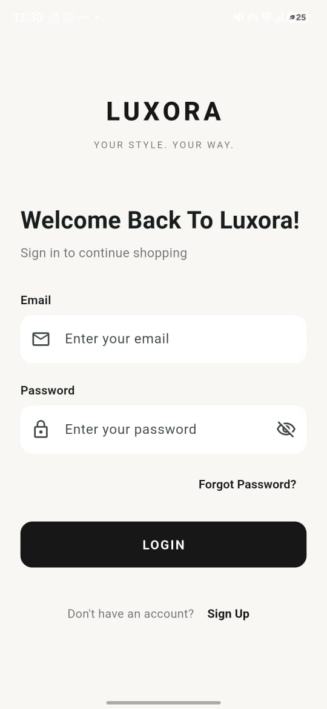
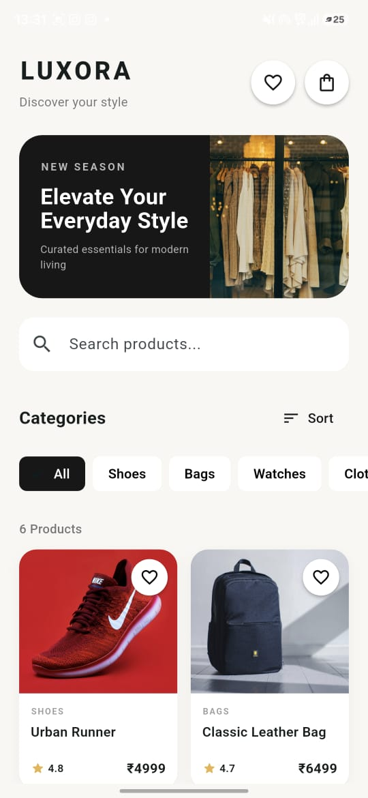
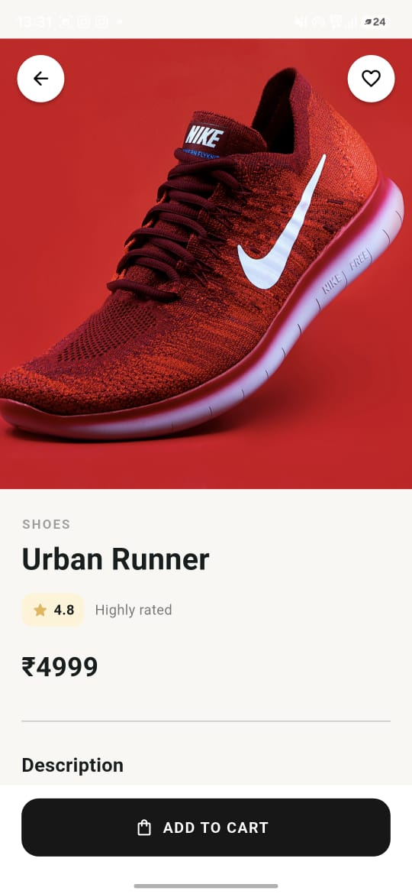
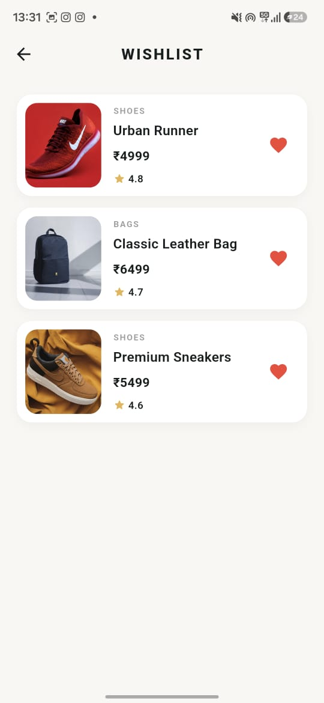
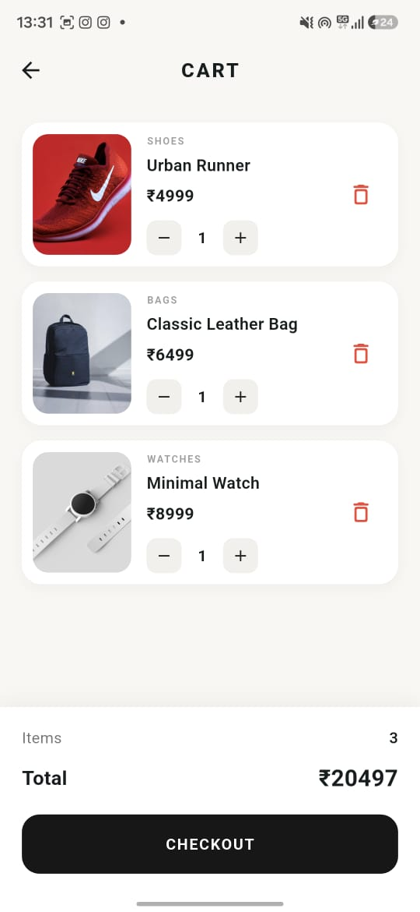

LUXORA

LUXORA is a modern fashion and lifestyle shopping application built with Flutter. It provides a clean shopping experience with product discovery, search, filtering, sorting, product details, wishlist, cart management, and infinite scrolling.

## Screenshots

### Login

### Home

### Product Details

### Wishlist

### Cart

Features

Modern login screen with email/password validation

Responsive home screen

Product catalog with 40 mock products

Product search

Category filtering

Product sorting

Default

Price: Low to High

Price: High to Low

Rating

Product details screen

Wishlist management

Add to cart

Increase/decrease cart quantity

Remove products from cart

Dynamic cart item count

Dynamic cart total

Infinite scrolling with loading indicator

Responsive product grid for different screen sizes

Navigation between screens

Error handling for unavailable product images

Tech Stack

Flutter

Dart

Provider

Material 3

Mock/static product data

State Management

LUXORA uses the Provider package for application state management.

ShopProvider manages:

Wishlist state

Cart state

Product quantities

Cart item count

Cart total

The provider is registered at the application level so that the Home, Product Details, Wishlist, and Cart screens can access the same shopping state.

Infinite Scrolling

The Home screen uses a ScrollController to detect when the user approaches the bottom of the product list.

Products are loaded in batches instead of displaying all products at once.

The flow is:

Load the first batch of products.

Monitor the scroll position.

When the user gets close to the bottom, load the next batch.

Display a loading indicator while the next batch is being loaded.

Append the new products to the existing list.

Continue until all available mock products have been displayed.

A short delay is used to simulate an API/network request. In a production application, this can be replaced with a real API call.

Project Structure

lib/
├── main.dart
├── data/
│   └── products.dart
├── models/
│   └── product.dart
├── providers/
│   └── shop_provider.dart
└── screens/
├── login_screen.dart
├── home_screen.dart
├── product_details_screen.dart
├── wishlist_screen.dart
└── cart_screen.dart

Folder Responsibilities

models/
Contains application data models such as Product.

data/
Contains the mock product catalog used by the application.

providers/
Contains application state management using Provider.

screens/
Contains the main application screens.

Getting Started

Prerequisites

Flutter SDK

Dart SDK

Android Studio or another Flutter-compatible IDE

Android SDK for Android builds

Installation

Clone the repository:

git clone <YOUR_GITHUB_REPOSITORY_URL>

Move into the project directory:

cd Luxora

Install dependencies:

flutter pub get

Run the application:

flutter run

To run it specifically in Chrome:

flutter run -d chrome

Build APK

To create a release Android APK:

flutter build apk --release

The generated APK will be available at:

build/app/outputs/flutter-apk/app-release.apk

Authentication

The current assessment version contains a login UI with basic validation.

Sign Up and Forgot Password are represented in the interface but do not have backend functionality because backend authentication was not required for the assessment.

Data

The application currently uses static/mock product data. No external backend or database is required to run the project.

The architecture can be extended later to connect the product catalog and authentication flow to a real backend/API.

Responsive Design

The application adapts the product grid according to the available screen width:

Small screens: 2 columns

Medium screens: 3 columns

Large screens: 4 columns

The login screen and other layouts are also designed to work across different screen sizes.

Future Improvements

Possible production-level improvements include:

Real backend/API integration

User authentication

Persistent wishlist and cart

Product pagination from an API

Checkout and payment integration

Order history

User profiles

Push notifications

Product reviews and ratings

APK

A release APK can be generated using:

flutter build apk --release

Developer

Ronald KS

B.Tech Computer Science and Engineering

Built with Flutter and Dart.